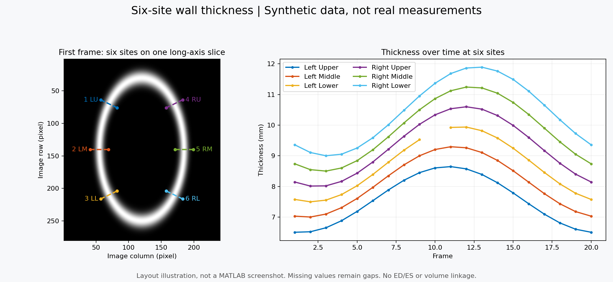

# Six-site local wall thickness

Requires MATLAB R2022a or newer and Image Processing Toolbox. Keep the `+wall`
folder beside `wall_thickness.m`. Extract into a new folder to avoid mixing
versions. The existing LV volume workflow remains available, but thickness
measurement does not require it and does not use ED/ES or calculate thickening
fractions. The former 3D workflow has been removed.

## Preview the layout

Run `demo_wall_thickness`. It calls the actual result display function using
synthetic images and curves; no DICOM is needed. The left panel shows six site
markers; the right shows six curves. One missing example measurement creates
a gap. This is a layout demonstration, not a measurement or accuracy test.



## Measure real data

1. Run `wall_thickness` to select a DICOM, or `wall_thickness(heart1)` to use
   loaded data. Alternatively, click **Wall thickness (6 sites)** in the viewer.
2. Source spacing in all three directions is assumed to be cm, as requested
   for this project; there is no unit-selection dialog. Select the first and last
   frame. Enter a frame interval in milliseconds only if it is known and
   constant; otherwise leave it blank.
3. Enter the long-axis slice number (the original viewer's Slice), thickness
   search range and translation search radius. The default 1-25 mm range is
   a search setting, not a physiological reference range.
4. On the first frame of the same slice, draw six lines in this order:
   **Left Upper, Left Middle, Left Lower, Right Upper, Right Middle, Right Lower**.
   Draw each line from inside the cavity through the wall to the outside,
   approximately perpendicular to the local wall. Double-click to finish.
   These labels describe screen positions, not anatomical wall names or
   standard myocardial segments.
5. All six candidate boundary segments appear together in a maximized window.
   Drag any colored segment or its endpoints to correct it. The sidebar lists
   thickness in both mm and cm, and the selected-site brightness profile.
   Use the site selector for **Redraw search line**, **Draw manual boundaries**,
   or **Skip selected site**. There are no per-site confirmation dialogs.
6. Click **Accept frame / Next** once after reviewing all six sites. Any site
   with no valid boundaries must be drawn or explicitly skipped first. Skipping
   affects only that site. In the next frame, a skipped site needs a new search
   line or manual boundaries. **Stop (keep earlier frames)** or closing the
   window retains earlier accepted frames; unaccepted current-frame edits are
   discarded and shown as `not_measured` if earlier results exist.
7. The final left panel shows the initial six locations on the first frame.
   The right panel shows six curves with matching colors. The x-axis is frame
   number, or seconds from the selected first frame if timing was provided.
   Thickness is in mm. Missing measurements are not interpolated.

## Save results

Each CSV row represents one frame and one site: `Frame`, `SiteID` (1-6),
`Site`, `Thickness_mm`, `Thickness_cm`, `Status`, and optional `Time_s`. Status is `skipped`,
`reviewed_auto`, `reviewed_corrected`, or `not_measured`. Missing values are
NaN, not zero. Site names are exported in English.

The MAT file also stores the first-frame image and initial lines, per-frame
and per-site boundary/search-line coordinates, units and settings, including the fixed cm source-unit assumption and its unverified calibration status.
CSV exports also include `SourceUnitAssumption` so the assumption travels with the measurements.

## Limitations and validation

The algorithm uses brightness-gradient detection and local 2D translation
matching. It cannot guarantee tracking the same 3D tissue. Rotation,
out-of-plane motion, shadows and papillary muscles can affect results;
review is required. Oblique measurement lines can overestimate thickness.
The six lines track independently: check that they retain their intended
upper/middle/lower positions.

MATLAB is unavailable in the cloud environment. Numerical tests and actual
GUI interaction have not been executed there. Run locally:

```matlab
results = runtests('tests/test_wall_algorithms.m');
assertSuccess(results)
```

Also check initialization of all six lines, independent tracking in the
second frame, correcting/skipping one site, missing values after stopping
partway through a frame, and the correspondence between curves and CSV site
labels. Try a few frames before measuring a complete cycle.

## Project unit convention and resampling

The reported X/Y unit tags are both 0 (None). They do not establish cm or mm.
At the user request, this project now treats **all three original spacing
values, including private depth spacing, as cm**. This is an explicit
assumption, not an automatic or verified DICOM calibration. The startup
instructions, review panel, result plot and saved results identify it.
No further diagnostic run is required to use this chosen convention.

`resampleDicom` makes voxel spacing isotropic in the same numerical length
unit as its input. It changes sampling density, not the physical unit, and
cannot discover a missing unit. The `wall_thickness` entry point alone
multiplies the spacing vector by 10 to use mm for distance calculations. It
does not mutate the input volume or convert it again on subsequent runs.
For the reported study, the original minimum spacing is 0.06314658179 cm;
after resampling the existing method gives approximately 0.6314658179 mm
per voxel in all three directions under this assumption.

Review shows both mm and cm; curves remain in mm; the CSV has both columns.
For identical points, measurements previously made using the mm option are
multiplied by 10 under the cm assumption. Automatic boundary selection may
also change because thickness search limits are specified in mm. No result
is clipped to the expected physiological range. Check the detected boundaries
before interpreting a large or small thickness.

The original LV volume workflow continues to use its existing cm convention.
No ED/ES or volume linkage is added to the wall measurement workflow.
`diagnose_dicom_units` remains available for future metadata investigation,
but is not a prerequisite to using the explicit cm assumption.
